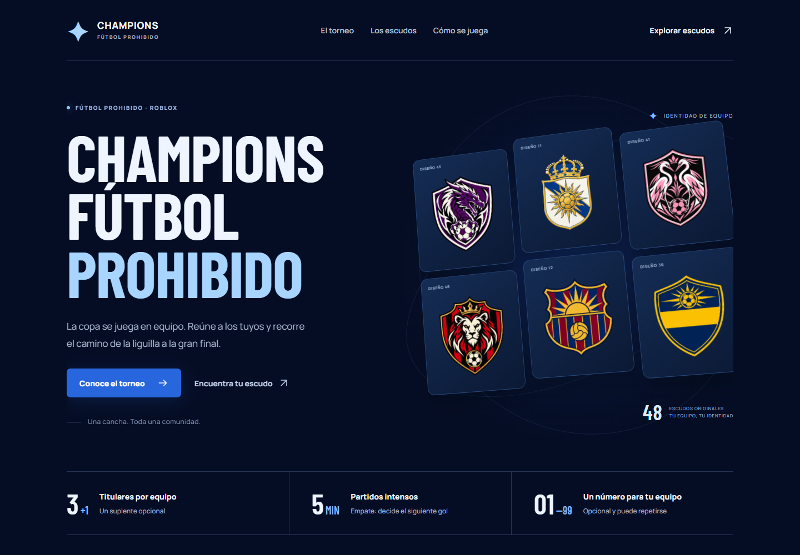
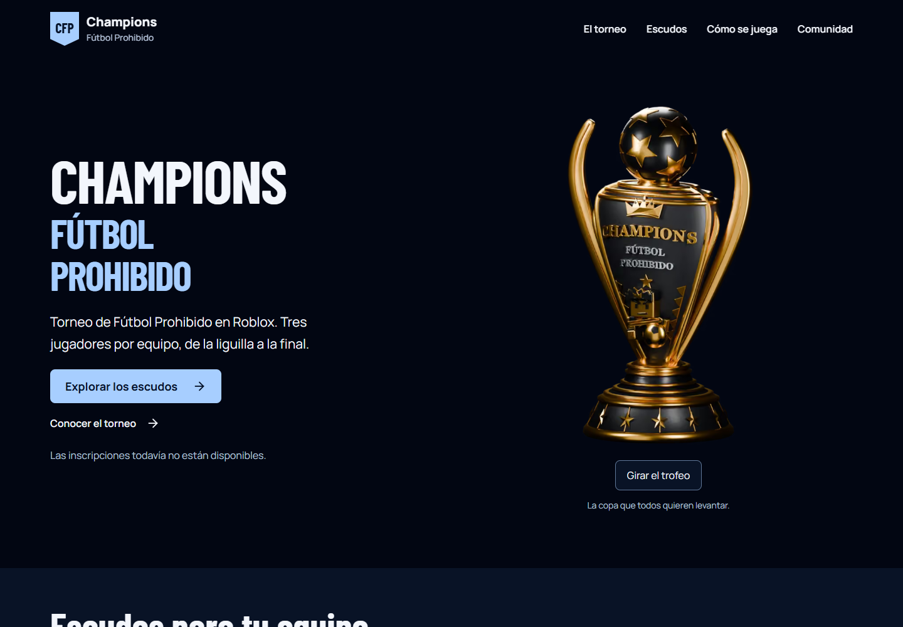
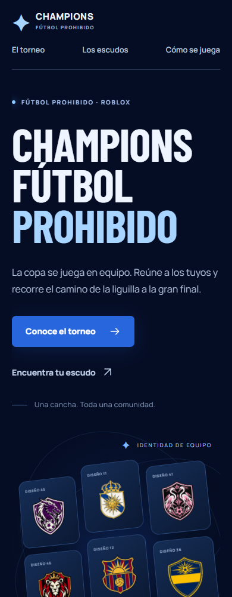
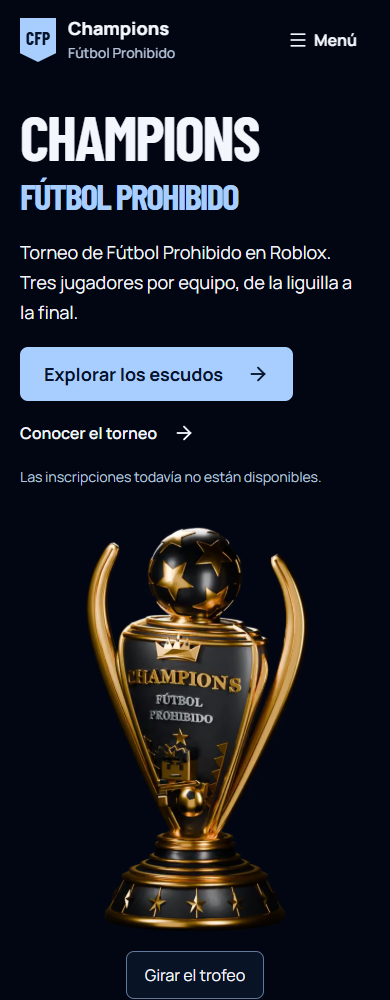

# Antes y después

Mismo contenido real y mismos 48 escudos. El rediseño cambia la composición, la navegación, la lectura y la exploración.

## Escritorio, 1440 px

| Antes                                                                        | Después                                                                  |
| ---------------------------------------------------------------------------- | ------------------------------------------------------------------------ |
|  |  |

[Antes: página completa](../output/playwright/before-1440-full.png) · [Después: página completa](../output/playwright/after-1440-full.png).

## Móvil, 390 px

| Antes                                                                  | Después                                                            |
| ---------------------------------------------------------------------- | ------------------------------------------------------------------ |
|  |  |

[Antes: página completa](../output/playwright/before-390-full.png) · [Después: página completa](../output/playwright/after-390-full.png).

## Lectura al 200 %

Zoom nativo de Edge en una ventana de 1440 px: viewport CSS de 708 px, DPR 2 y `zoom` CSS sin modificar. Son capturas de viewport para evitar el recorte incorrecto de imágenes que Chromium produce al capturar toda la página con zoom nativo.

[Portada al 200 %](../output/playwright/native-zoom-200-hero.png) · [Galería al 200 %](../output/playwright/after-zoom-200.png) · [Estado sin resultados](../output/playwright/after-empty.png).
