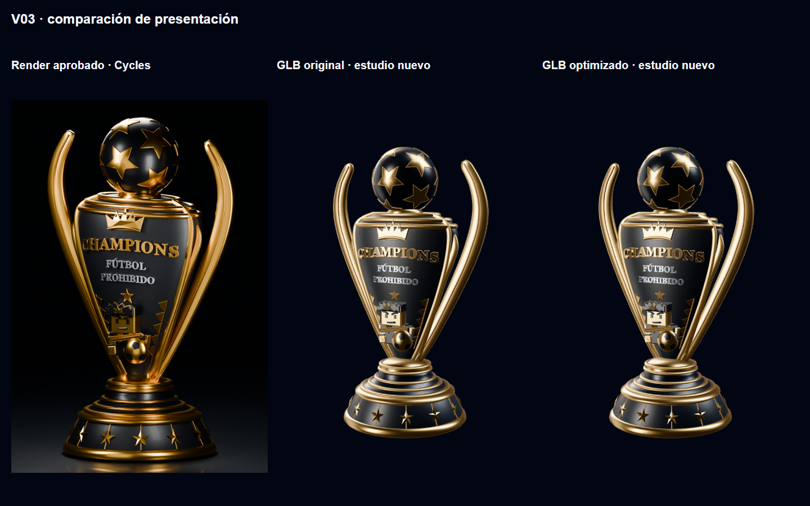

# Bloque 1: presentación, participación y vacíos

## Cambios

- Conserva el GLB Draco V03, geometría, proporciones, cinco materiales y 173 mallas. Los originales .blend/GLB permanecen intactos fuera de public.
- Nuevo HDR de 1024×512 generado en Blender a partir de posiciones y dimensiones de los cuatro softboxes del estudio aprobado. Oro más definido, negro profundo y plata legible; tone mapping AgX y exposición 1. La imagen permanece hasta cargar modelo, HDR y dos frames de preparación.
- Órbita inicial 28,81° / 82,56°, próxima a la cámara del render aprobado; reset frontal 0°/90°, giro directo y teclado. Escala mínima de render 0,75 frente a 0,5 para reducir la degradación automática. Ocultación fuera de pantalla, scroll vertical táctil y alternativa ante fallos conservados.
- CTA orientada a participar: inscripción, selección de varios eventos, espera al llenarse o comunidad si no hay inscripciones abiertas. Consulta una proyección pública por un endpoint de solo lectura; no bloquea la portada estática. Los escudos quedan secundarios.
- La selección de eventos explica plazas y espera; las pendientes ocupan plaza. En un evento lleno el formulario propone espera, sin reservar datos y sin promoción automática.
- Acción Crear evento unificada; el nuevo formulario explica guardar inicialmente un borrador. Eliminatorias sin eventos explica que antes debe cerrarse la clasificación de liguilla.

## Comparación controlada

Original y optimizado se capturaron con idéntica cámara (28,81°/82,56°/22,5 m), exposición, HDR, resolución 720×900 y DPR1. Se comparó cada pareja tanto con la presentación anterior como con el nuevo estudio. [Parámetros](evidencia-presentacion/comparison.json), [diferencia de píxeles](evidencia-presentacion/pixel-comparison.json).

El error medio entre original y comprimido fue 0,0245/255 antes y 0,0458/255 después. Materiales, metalicidad, rugosidad y clearcoat coinciden; la cuantización produce diferencias dimensionales inferiores a 0,000024 unidades. No se atribuye el aspecto plano a Draco. El entorno previo tenía un fondo ambiental amplio y reflejos poco contrastados; el nuevo estudio mejora el volumen sin cambiar materiales.

Blender contiene un bump procedural en Obsidiana que ninguno de los dos GLB lleva horneado. El visor tampoco reproduce exactamente la oclusión y el trazado de rayos de Cycles: esa microtextura y las sombras locales siguen diferenciando el render aprobado del visor. Se conserva el material y se identifica la aproximación, sin prometer una igualdad píxel a píxel entre motores distintos.

Original: 10 781 576 bytes. Copia web: 1 631 132 bytes, sin aumento. HDR previo 39 740 bytes; HDR nuevo 108 263 bytes: +68 523 bytes. No se justifica descargar el GLB original por una diferencia visual despreciable en la prueba controlada.

Grabación del giro real con mouse y reset: `C:/Users/XT/Projects/cfp-presentation-tests/giro-3d.webm`. No es una animación precalculada del trofeo.

## Pruebas y límites

- TypeScript, ESLint, assets (48 escudos, cinco materiales V03) y build correctos.
- Galería: cinco anchuras, diez filtros, búsqueda, historial, foco, movimiento reducido, zoom nativo 200%, Axe y consola: PASS. [Registro](evidencia-presentacion/portada.json).
- Trofeo: carga automática, HDR, teclado, reset, ocultación, fallo de red y scroll táctil sintetizado: PASS. Corrida final: LCP 1012 ms, 3D listo 12 317 ms, 2 012 437 bytes hasta estar listo; las condiciones se detallan en el JSON y no implican una mejora garantizada de velocidad. [Registro y simulación móvil](evidencia-presentacion/trofeo.json). Simulación Edge de escritorio, no teléfono físico ni Lighthouse.
- Cuatro CTA verificadas con respuestas públicas controladas y también con PostgreSQL local real y RPC pública. Auth/transporte de esa segunda prueba siguen simulados; la lista de eventos se filtró a fixtures. Sin TikTok en el endpoint público. [Registro](evidencia-presentacion/availability-db.json).
- El cambio inicial a portada dinámica reveló un conflicto de actualización diferida de filtros tras usar historial. Se separó la consulta de disponibilidad y se repitió la suite completa: PASS; la portada permanece estática.
- Detector de diseño: avisos de tamaños preexistentes descritos en la jerarquía responsiva (por ejemplo 36 px), no defectos nuevos ni cambios de tokens.

No hubo migraciones ni eventos de demostración en producción. Turnstile fue retirado expresamente por el propietario del encargo; los límites persistentes y la privacidad se abordan en el bloque 2.
