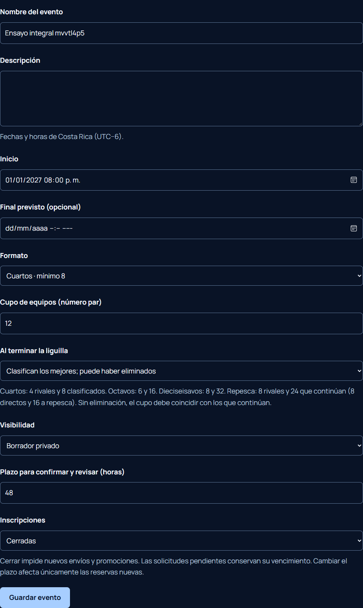
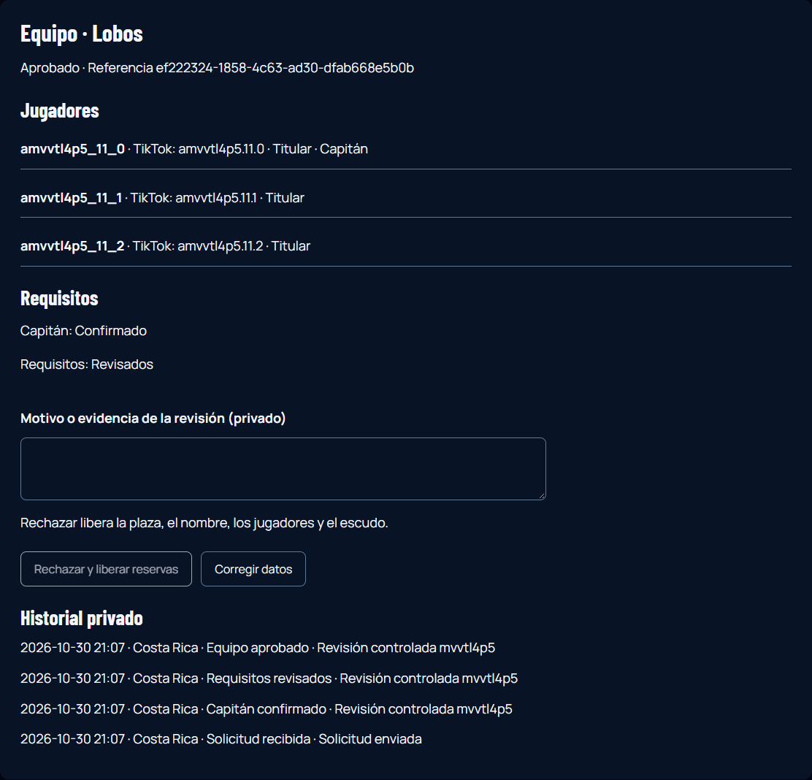
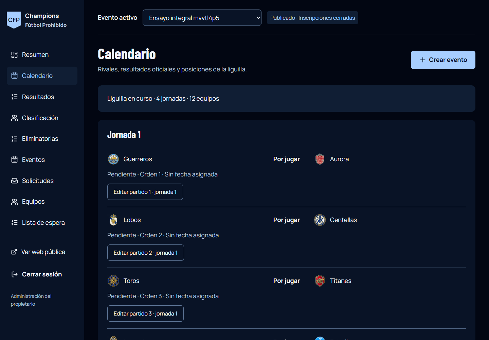
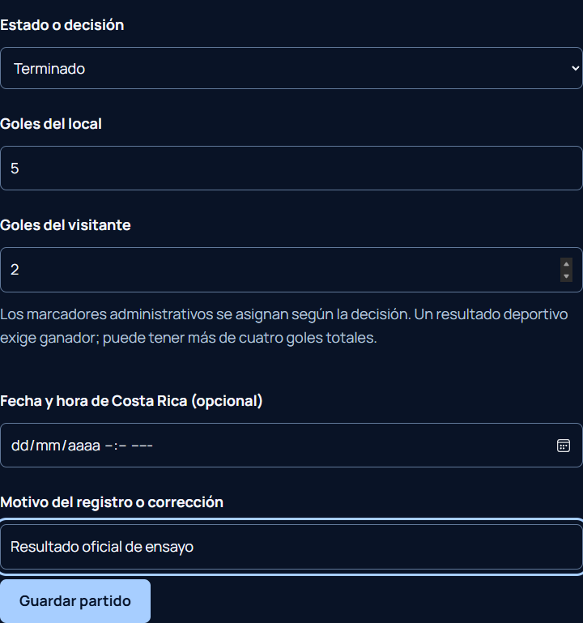
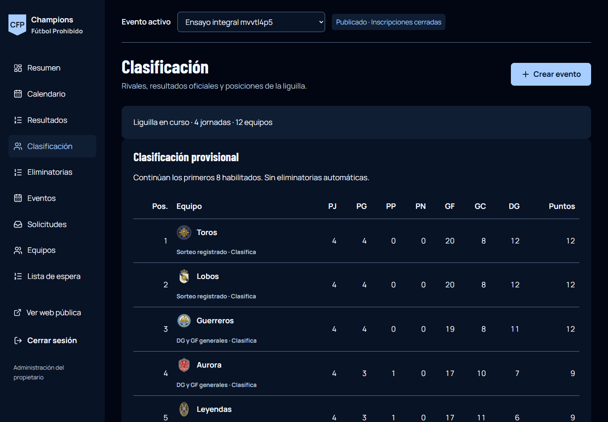
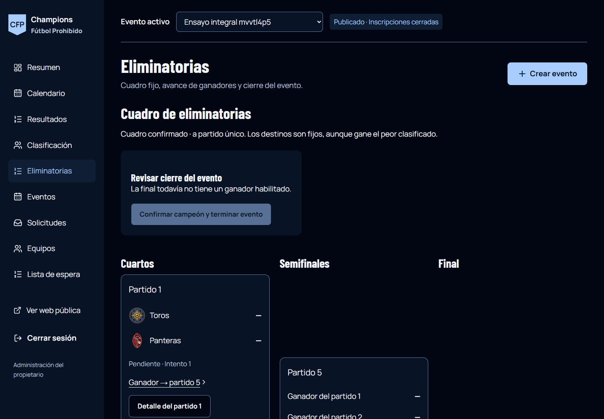
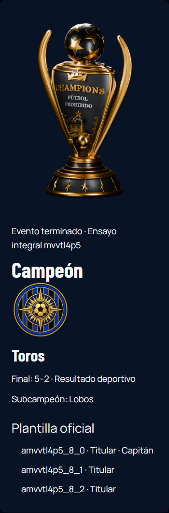

# Tu primer evento CFP

Puedes practicar ahora en la [demostración local recuperable](demostracion.md). No inaugura un torneo ni usa cuentas reales. El [informe actualizado](mejoras-bloque-5.md) distingue todas las pruebas.

Capturas reales del ensayo aislado; equipos y usuarios ficticios. El acceso del ensayo es simulado. [Alcance de la revisión](revision-integral.md).

Entra en [Administración](https://champions-futbol-prohibido.vercel.app/admin/acceso) con tu correo. Revisa siempre **Evento activo** antes de actuar.

## 1. Crea y abre

**Eventos → Crear evento.** Completa nombre, fecha de Costa Rica, formato y cupo par. Guarda primero como **Borrador privado / Cerradas**.

Para doce equipos: **Cuartos**, cupo **12**, «Clasifican los mejores»; cuatro rivales por equipo y ocho clasificados.

Después guarda **Publicado**. Comprueba su página pública. Antes de abrir, completa el aviso definitivo y la identificación legal, valida e implementa la autorización de menores y la confirmación individual, resuelve la adaptación de TikTok y revisa los plazos provisionales de conservación. [Propuesta concreta](privacidad-propuesta.md). La configuración de privacidad está inactiva y bloquea la apertura; consulta [el bloque 2](mejoras-bloque-2.md). Solo después de aprobar y activar esa versión podrás guardar **Abiertas** cuando estés listo.

## 2. Revisa solicitudes

**Solicitudes → Revisar equipo.** Comprueba Equipo, Jugadores y Requisitos. Confirma al capitán desde el TikTok declarado, marca seguimiento, grupo y amistad de cada integrante, confirma aparte al capitán y aprueba. El contador representa comprobaciones, no jugadores. No existe aprobación por excepción ni autorización familiar ficticia.

Rechazar libera reservas. Corregir exige verificar al solicitante y vuelve a revisión. **Lista de espera → Promover** exige plazas y datos disponibles; no aprueba automáticamente.

## 3. Cierra inscripciones

**Eventos → Configurar → Cerradas → Guardar evento.** Se bloquean nuevos envíos y promociones; las pendientes conservan su plazo. Una pendiente ocupa plaza.

Resuelve pendientes antes del sorteo. El primer cierre fija plantillas; reabrir no permite corregirlas. Debe quedar un número **par** de aprobados y alcanzar el mínimo del formato. Si queda impar, falta una decisión del reglamento: no improvises una solución.

## 4. Revisa y confirma el calendario

**Calendario → Generar revisión del calendario.** Comprueba equipos, cuatro jornadas, rivales y fechas. La revisión todavía es privada.

**Confirmar y fijar calendario** publica la fase y fija participantes/formato. Para doce equipos deben quedar **24 partidos**.

## 5. Guarda resultados

**Resultados → Editar partido.** Elige la decisión, introduce goles y motivo; guarda y comprueba el marcador. **5–2 es válido**; cuatro es la diferencia máxima, no el total de goles.

Las correcciones recalculan la tabla. Ausencia, abandono y caída general tienen decisiones propias; no inventes un marcador deportivo para representarlas.

### Usar LIVE y OBS

**LIVE** separa goles provisionales y resultado oficial. Solo el propietario convoca con sala disponible y puede registrar ausencia 3–0 tras cinco minutos, eligiendo el equipo y confirmando. El aviso de cuatro goles no guarda un resultado. Los ayudantes verificados y asignados solo editan el marcador de trabajo. OBS muestra únicamente datos públicos; puedes copiar los enlaces desde LIVE. [Uso y permisos](mejoras-bloque-4b.md).

## 6. Cierra la liguilla

**Clasificación.** Resuelve todos los partidos y pulsa cada **Sortear** pendiente. Comprueba las posiciones.

**Cerrar liguilla y conservar clasificación** fija la tabla final. No crea eliminatorias automáticamente.

## 7. Confirma eliminatorias y campeón

**Eliminatorias → Preparar revisión del cuadro.** Revisa cruces y destinos. **Confirmar cuadro fijo** lo publica y fija sus conexiones.

Abre **Detalle del partido**, guarda cada resultado y revisa el ganador. Para corregir un ganador con partidos dependientes disputados, primero retira explícitamente esos resultados; conserva el motivo.

Tras los siete partidos, revisa la final y pulsa **Confirmar campeón y terminar evento**. Comprueba campeón y plantilla Roblox en la página pública. El cierre queda inmutable en esta etapa.

## Qué guarda y qué fija

| Acción | Efecto |
| --- | --- |
| Guardar borrador | Solo administración |
| Guardar Publicado | Evento visible; no abre por sí solo |
| Guardar Abiertas / Cerradas | Admite o detiene envíos; el primer cierre fija plantillas |
| Generar revisión | Guarda una propuesta privada |
| Confirmar calendario / cuadro | Publica la fase y fija sus participantes o conexiones |
| Guardar resultado | Actualiza resultados públicos e historial privado |
| Cerrar liguilla / confirmar campeón | Conserva el cierre de esa fase |

Si falla la conexión, conserva la página y comprueba el listado o resultado antes de repetir una creación. Si otra pestaña cambió el evento, recarga y revisa sus datos antes de guardar otra vez.

## 8. Comparte y conserva

En la página pública consulta próximos horarios, equipo, partido e historial. Descargar ICS no sincroniza cambios posteriores. **Exportar** descarga PNG de la página visible, PDF completo por páginas y CSV completo; neutraliza fórmulas en textos. La revelación reproduce el sorteo confirmado, sin cambiar rivales. Un clip es privado salvo publicación explícita y no sustituye las autorizaciones necesarias.

## Antes de inaugurar

No abras las inscripciones reales durante la revisión personal. [Bloqueos y mejoras opcionales](mejoras-bloque-5.md#qué-sigue-pendiente). Turnstile está descartado. La prueba aislada de Auth/PostgREST reales continúa pendiente; no se confunde con el acceso simulado de la demostración.
